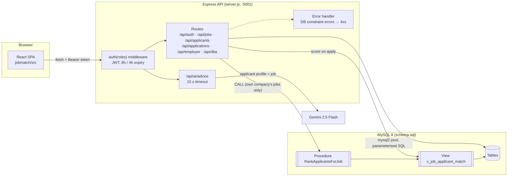
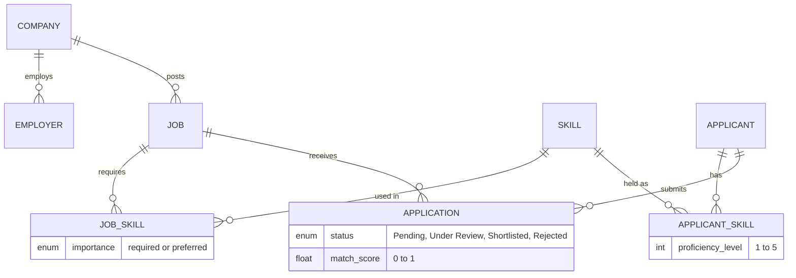

# Architecture

JobMatch has three parts: a React + Vite single-page app (`jobmatch/`), an Express API (`server.js`) and a MySQL 8 database (`schema.sql`). The API is the only component that talks to MySQL and to Gemini. The browser never sees the Gemini key.



## Roles

| Role | How they log in | What they can do |
|---|---|---|
| Applicant | `APPLICANT` row, bcrypt password | Edit profile and skills, browse and apply to jobs, ask the AI advisor |
| Employer | `EMPLOYER` row, bcrypt password | Post jobs, see and rank applicants **for their own company's jobs only**, set application status |
| DBA | Demo accounts hard-coded in `server.js` | View whitelisted tables (no password hashes). Update whitelisted columns (`UPDATE` permission). Create MySQL users (`CREATE USER` permission) |

## Data model



`APPLICATION` has a unique `(applicant_id, job_id)` pair, so an applicant can apply to a job only once. `CHECK` constraints keep experience non-negative, proficiency between 1 and 5, and `match_score` between 0 and 1. The API turns violations of these into 400/409 responses.

## Match score

`v_job_applicant_match` scores every (applicant, active job) pair:

```
score = 0.20 × experience  (1 if experience ≥ min_experience, else experience / min_experience)
      + 0.60 × share of the job's required skills the applicant has   (1 if the job lists none)
      + 0.20 × share of the job's preferred skills the applicant has  (1 if the job lists none)
```

It is rounded to 2 decimals. `POST /api/applications` stores the score at apply time. `RankApplicantsForJob(job_id)` joins the view with `APPLICATION` and ranks applicants with `RANK() OVER (ORDER BY match_score DESC)`.

## Testing

`test/api.test.js` runs the Express app against a fake pool. `test/db.test.js` runs it against a real MySQL loaded with `schema.sql`, which exercises the view, the procedure and the constraints. See the README for how to run both.
